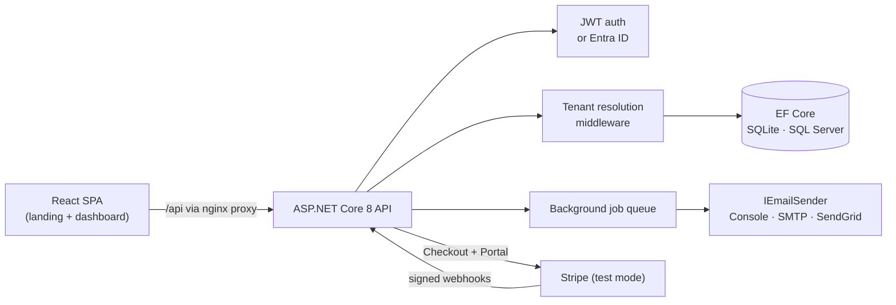

# .NET SaaS Starter — ship your SaaS this weekend

[](https://github.com/varunkonnojutech-lab/dotnet-saas-starter/actions/workflows/ci.yml)
[](LICENSE)
[](https://dotnet.microsoft.com/)
[](https://codespaces.new/varunkonnojutech-lab/dotnet-saas-starter)

Every SaaS starts with the same six weeks of plumbing — signups, workspaces, roles, billing, emails — before you write a single line of the product people actually pay for. This starter does that plumbing the way a production system does it, so you start at week seven.

**One command runs everything:**

```bash
docker compose up --build
# Web app:  http://localhost:5173
# API docs: http://localhost:8080/swagger
```

Demo logins (two fully isolated tenants): `demo@acme.test` / `Demo123$` and `demo@globex.test` / `Demo123$`

## Who is this for

- **Founders / indie hackers** who want to charge money for a .NET product without spending a month on infrastructure first.
- **Senior .NET developers** evaluating how multi-tenancy, Stripe billing and JWT auth should actually be structured.
- **Learners** who have finished the tutorials and want one complete, honest, runnable system to read end to end.

## What you get

| Feature | Where it lives |
|---|---|
| **Multi-tenancy** — tenant resolution middleware, per-tenant isolation via EF Core global query filters, tenant id stamped on save (never trusted from the client) | `Infrastructure/Tenancy`, `Infrastructure/Data/AppDbContext.cs` |
| **Auth** — ASP.NET Core Identity + JWT (tenant id + role in the token), Owner/Admin/Member roles, plan quotas for members & projects | `SaasStarter.Api/Controllers/AuthController.cs`, `TenantsController.cs` |
| **Microsoft Entra ID** — flip `AzureAd:Enabled=true` and the API validates Entra tokens instead of local JWTs; controllers don't change | `Program.cs`, `appsettings.json` |
| **Stripe billing (test mode)** — Checkout sessions, Billing Portal, and a signature-verifying webhook handler that syncs plan + subscription status. No real keys anywhere | `Infrastructure/Billing` |
| **Email abstraction** — one `IEmailSender`, three providers: Console (dev), SMTP, SendGrid (v3 API) | `Infrastructure/Email` |
| **Background jobs** — channel-based queue + hosted service; the welcome email on signup is the first job | `Infrastructure/Jobs` |
| **React app** — landing page with live pricing, auth, and an admin dashboard (overview, projects, team, billing) | `frontend/` |
| **Docker** — Compose stack: API + React (nginx) + SQLite volume; zero-config start | `docker-compose.yml` |
| **Terraform for Azure** — App Service, Azure SQL, Key Vault, Application Insights, managed identity | `infra/terraform/` |
| **Tests that prove the promise** — 11 tests; the important ones prove one tenant cannot see another tenant's data over real HTTP | `tests/` |

## Architecture



```
src/
  SaasStarter.Domain/          Tenant, Plan, ApplicationUser, Project — no frameworks, just the model
  SaasStarter.Infrastructure/  DbContext + tenant filters, JWT, email, Stripe, job queue, seeding
  SaasStarter.Api/             Controllers, tenant middleware, Swagger, Program.cs wiring
tests/
  SaasStarter.Tests/           DbContext isolation tests, JWT tests, WebApplicationFactory integration tests
frontend/                      Vite + React 18 + TypeScript
infra/terraform/               Azure: App Service, Azure SQL, Key Vault, App Insights
```

### How tenant isolation works (the important part)

1. Login issues a JWT carrying `tenant_id` and `role` claims.
2. `TenantContext` reads the claim per request; an optional `X-Tenant-Slug` header can *confirm* the tenant, never switch it.
3. `AppDbContext` applies `HasQueryFilter(p => p.TenantId == tenantContext.TenantId)` to every tenant-owned entity and stamps `TenantId` on insert.
4. Controllers therefore contain **zero** tenant `WHERE` clauses — and the integration tests prove isolation holds anyway.

## Quick start

### Docker (recommended)

```bash
git clone https://github.com/varunkonnojutech-lab/dotnet-saas-starter
cd dotnet-saas-starter
docker compose up --build
```

Open http://localhost:5173, log in with a demo account, create projects, add members, try the other demo tenant and watch the data change completely.

### Local dev (no Docker)

```bash
dotnet run --project src/SaasStarter.Api        # http://localhost:8080 (Swagger in Development)
cd frontend && npm install && npm run dev       # http://localhost:5173, proxies /api to the API
```

First run creates a local SQLite file and seeds the plans + demo tenants. Set `Database__SeedDemo=false` to skip demo data; set `Database__Provider=SqlServer` + `ConnectionStrings__DefaultConnection` to use SQL Server / Azure SQL.

### Codespaces

Click the Codespaces badge above — the devcontainer installs the .NET 8 SDK, Node 20 and restores everything.

## Turn on Stripe (test mode)

Billing ships disabled-but-wired: without keys, checkout answers with a clear "not configured" message instead of pretending.

1. In the [Stripe test dashboard](https://dashboard.stripe.com/test), create two recurring Prices: **Pro $29/mo** and **Team $99/mo**.
2. Copy `.env.example` to `.env` and fill in `STRIPE_SECRET_KEY` (`sk_test_...`) and the two `price_...` ids.
3. Forward webhooks to your machine and paste the printed `whsec_...` into `STRIPE_WEBHOOK_SECRET`:
   ```bash
   stripe listen --forward-to localhost:8080/api/billing/webhook
   ```
4. `docker compose up --build` again, upgrade a workspace from the Billing tab, and pay with the test card `4242 4242 4242 4242`. The webhook flips the tenant to **Pro / Active** — the browser redirect never changes plan state; only Stripe's signed webhook does.

## Turn on Entra ID

Register an app in Microsoft Entra ID, then set `AzureAd:Enabled=true` plus `TenantId`/`ClientId` in `appsettings.json` (or env vars `AzureAd__TenantId` etc.). The API then validates Entra-issued tokens via Microsoft.Identity.Web. Map your tenant id into a `tenant_id` claim with a claims-mapping policy or token configuration — the controllers only ever read claims.

## Run the tests

```bash
dotnet test
```

- `TenantIsolationTests` — DbContext-level proof of the query filter + tenant stamping.
- `AuthAndProjectsTests` — full HTTP flows: register → create → isolation between tenants, demo-tenant isolation, plan quota enforcement.
- `BillingTests` — members are blocked from billing by policy; a fabricated `checkout.session.completed` webhook upgrades the tenant's plan.
- `JwtTokenServiceTests` — issued tokens carry tenant + role and validate.

## Deploy to Azure

```bash
cd infra/terraform
cp terraform.tfvars.example terraform.tfvars   # fill in passwords/keys
terraform init && terraform apply
```

Creates a resource group, Linux App Service (.NET 8), Azure SQL, Key Vault (the API's managed identity can read secrets), Log Analytics + Application Insights, and injects connection string + keys as app settings. CI validates the Terraform on every push.

## Roadmap / make it yours

- Replace `Project` with your real domain objects — they inherit tenant isolation by implementing `ITenantOwned`.
- Add EF Core migrations for production schema changes (the starter uses `EnsureCreated` so the demo runs anywhere).
- Swap the in-process job queue for Hangfire or Azure Queue Storage when you need durable retries — the `IBackgroundJob` shape stays the same.
- Wire the React Billing buttons to your real Stripe prices and go live with production keys (outside the repo, in Key Vault / env vars).

## License

MIT — see [LICENSE](LICENSE). Build something people pay for.
